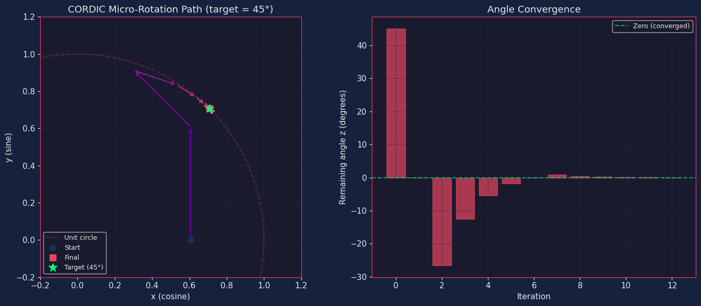
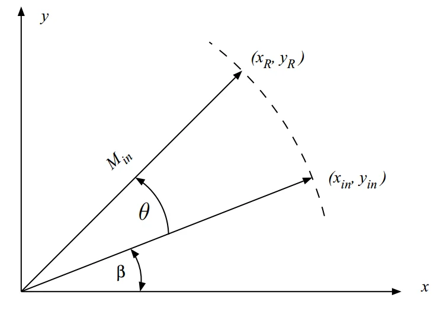
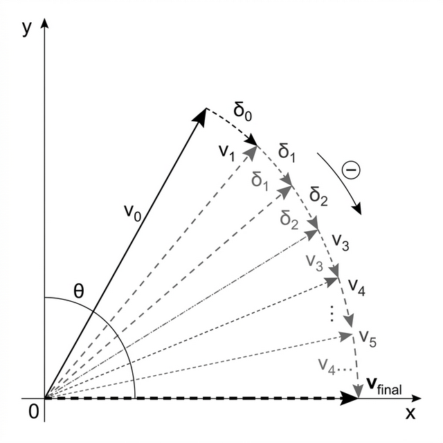
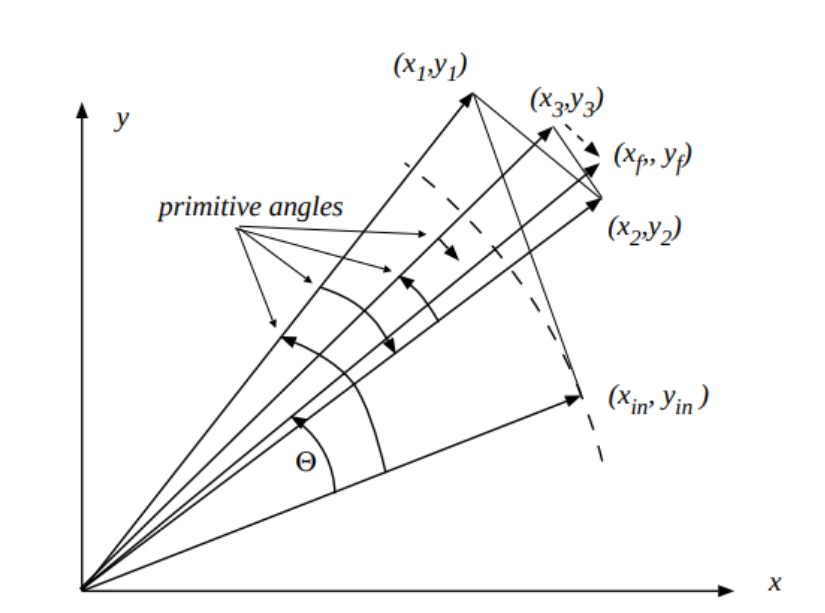

# CORDIC (COordinate Rotation DIgital Computer)

CORDIC is a highly efficient hardware algorithm for calculating mathematical functions like sine, cosine, magnitude, phase, and square roots. It works by performing a series of simple micro-rotations using only **bit-shifts** and **additions**, completely avoiding the need for expensive hardware multipliers.

## The Principle of Micro-Rotations

The core concept relies on iteratively rotating a vector by pre-defined angles ($\alpha_i$) chosen specifically so that their tangent is a descending power of 2 (i.e., $\tan(\alpha_i) = 2^{-i}$). This mathematical trick simplifies the complex matrix rotation into simple shift arrays.

## Operating Modes

The CORDIC algorithm generally operates in two fundamental modes depending on which internal variable it is attempting to drive to zero:

### 1. Rotation Mode
In Rotation Mode, the target angle ($Z$) is constantly driven towards zero. The sequence of micro-rotations is determined by the sign of the remaining angle. This mode is exceptionally useful for calculating trigonometric functions, most notably rotating a vector to compute **Sine** and **Cosine**.

### 2. Vectoring Mode
In Vectoring Mode, the vector's y-coordinate ($Y$) is iteratively driven to zero. This effectively rotates the vector until it aligns cleanly with the positive x-axis. The final accumulated angle represents the original phase mapping (used for **Arctangent**), and the accumulated x-coordinate represents the total vector magnitude.

*(A supplementary overview of micro-rotation execution)*

## Package Contents

This repository contains robust, hardware-verified Verilog implementations of these varying CORDIC components:

* **`src/cordic.v`**: Standard Circular CORDIC module (Rotation Mode) tailored for calculating $\sin(\theta)$ and $\cos(\theta)$.
* **`src/cordic_sqrt.v`**: Specialized Hyperbolic CORDIC (Vectoring Mode) structured to calculate fractional square roots.
* **`src/cordic_sqrt_wrapper.v`**: Advanced normalization wrapper for the square root core. It handles arbitrarily large 32-bit integers, shifting them automatically into the core's fixed-point domain (Q1.15) for safe calculation.
* **`src/cordic_top.v`**: A top-level wrapper merging the circular CORDIC core seamlessly with its required Look-Up Tables into a single AXI-friendly IP block.
* **`src/atan_lut.v` / `src/atanh_lut.v`**: Fixed-point combinational ROM structures storing the inverse tangent and hyperbolic inverse tangent rotation variables.

### Testing
All primary logic modules are accompanied by fully self-checking Verilog testbenches located in `tb/verilog/`. You can conveniently run them utilizing the attached `Makefile` targets.
