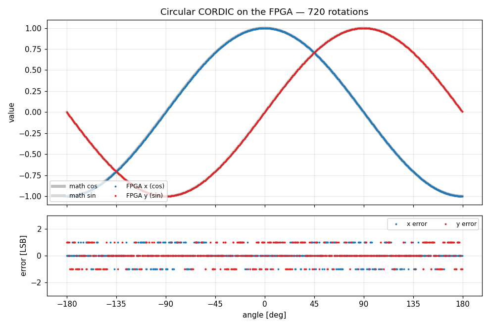
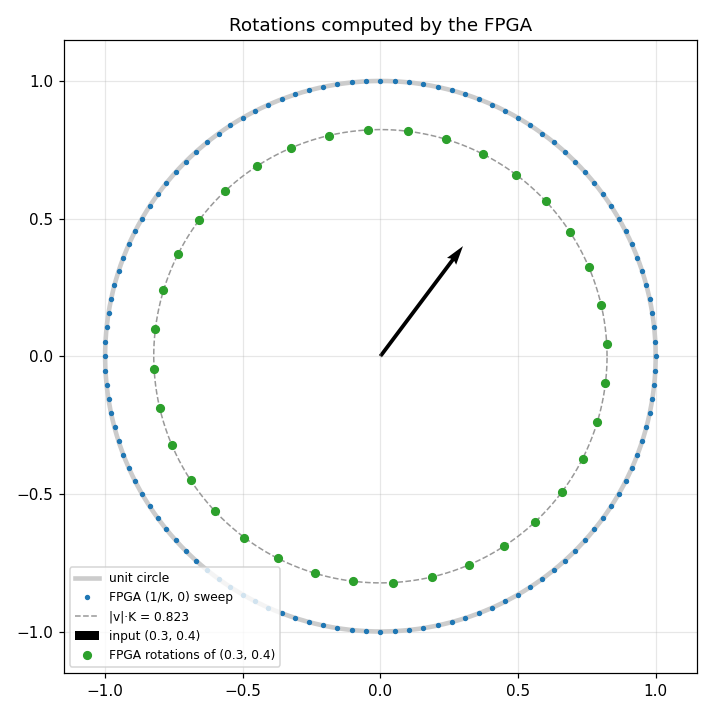
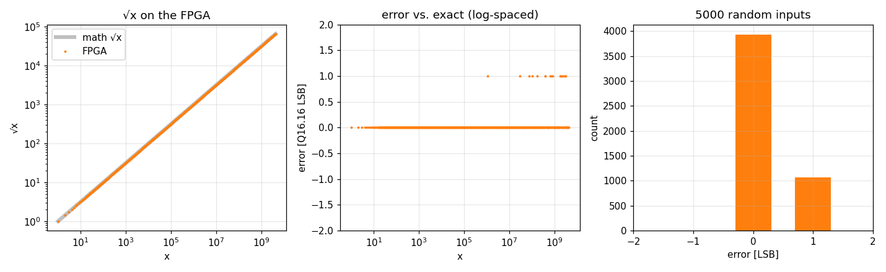
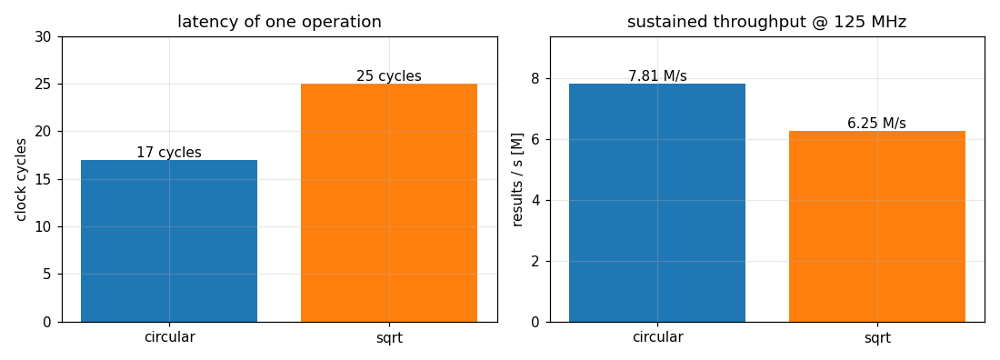

# CORDIC hardware test on the Red Pitaya

This folder runs the repository's two CORDIC designs on a **Red Pitaya STEMlab 125-14** (tested on a PRO Gen 2 with a Zynq-7020, Red Pitaya OS 3.00) and checks them from Linux on the board:

* `cordic_top`: circular CORDIC in rotation mode.
* `cordic_sqrt_wrapper`: 32-bit integer → Q16.16 square root.

```
 Zynq PS (Linux) ── M_AXI_GP0 ── AXI Interconnect ── cordic_axi_regs ──┬── cordic_top
   /dev/mem @ 0x4000_0000        (AXI3 → AXI4-Lite)   (registers)      └── cordic_sqrt_wrapper
                                                         │
                                       FCLK_CLK0 125 MHz ┘     LEDs [7:0]
```

The test script on the board writes inputs through registers, starts each operation, and compares every result against exact math, using the same tolerances as the RTL testbenches. It also measures the real FCLK frequency and the sustained throughput (bursts of 10 000 back-to-back operations).

## Results on hardware

Measured on a STEMlab 125-14 PRO Gen 2 (Zynq-7020, Red Pitaya OS 3.00), built with Vivado 2025.1. Timing closes at 125 MHz with WNS = +0.221 ns.

| Check | Result |
|---|---|
| Circular CORDIC | 50 381 vectors, max error 2 LSB (Q1.15), residual phase ≤ 2 LSB, 0 failures |
| Square root | 50 108 vectors, max error 1 LSB (Q16.16), 0 failures |
| Circular throughput | 16.00 cycles/result → 7.81 M results/s |
| Square-root throughput | 20.00 cycles/result → 6.25 M results/s |
| Latency of one operation | circular 17 cycles, square root 25 cycles (from the `C_CTRL` / `S_CTRL` write to the result) |
| FCLK0 | 125.00 MHz (measured) |
| Utilization | 2009 LUTs (3.8 %), 1682 FFs (1.6 %), 4 DSP48 (1.8 %), no BRAM |

Plots produced by the notebook (`make plots`). Every point was computed by the FPGA, with the exact math drawn underneath:









### Timing closure

The first build missed 125 MHz on two paths. Both are fixed in `src/`, so the cores now close timing on their own:

* **`cordic_sqrt_wrapper`, −5.96 ns.** The multiply by 1/K_h, the rounding, the exponent shift and the saturation all ran in a single cycle: 19 logic levels, 13.7 ns. They are now a 5-stage pipeline (S1–S5). Latency goes from 20 to 24 cycles and the throughput stays at 20 cycles/result.
* **`cordic`, −1.30 ns.** The output was rounded from the shared micro-rotation datapath, which also carries the first-iteration input mux. That created a structural path from input to fold to rotate to round to output in one cycle. It is never used functionally, but timing analysis still counts it. The outputs are now computed from the internal registers, with a constant shift in the last iteration. Cycle behaviour is identical, and all testbenches pass unchanged.

## Layout

| Path | Contents |
|---|---|
| `rtl/cordic_axi_regs.v` | AXI4-Lite slave with the register map. It instantiates both cores |
| `rtl/red_pitaya_cordic_top.v` | Board top level: PS block design, the register block, and the LEDs |
| `bd/system.tcl` | Block design: PS7 → AXI Interconnect → external `M_AXI`, plus `FCLK_CLK0` and reset |
| `bd/ps7_config.tcl` | Red Pitaya PS7 configuration, copied from the official [RedPitaya-FPGA](https://github.com/RedPitaya/RedPitaya-FPGA) repo (BSD) |
| `sdc/red_pitaya_cordic.xdc` | LED pin constraints |
| `build.tcl` | Vivado batch build. It fails if timing is not met |
| `tb/tb_cordic_axi_regs.v` | AXI4-Lite testbench of the register block, with random AW/W ordering |
| `sw/cordic_hw_test.py` | On-board test, Python standard library only. The notebook imports it as a module |
| `sw/cordic_explorer.ipynb` | Graphical explorer for the board's JupyterLab: plots and interactive sliders |
| `docs/*.png` | Plots measured on the board, shown in this README |
| `Makefile` | `sim`, `lint`, `build`, `info`, `deploy`, `test`, `hw`, `notebook`, `plots` |

## Register map (base `0x4000_0000`)

| Offset | Name | Access | Description |
|---|---|---|---|
| `0x000` | `ID` | R | `0x43524443` ("CRDC") |
| `0x004` | `VERSION` | R | `0x00010000` |
| `0x008` | `SCRATCH` | RW | Free. Bits [3:0] drive LED[7:4] |
| `0x00C` | `CYCLES` | R | Free-running clock counter |
| `0x100` | `C_CTRL` | W | bit0 starts one operation, bit1 starts a burst of `C_BURST_N` |
| `0x104` | `C_STATUS` | R | bit0 busy, bit1 done, bit2 input ready |
| `0x108`–`0x110` | `C_X_IN`, `C_Y_IN`, `C_PHASE_IN` | RW | x0, y0 (Q1.15), z0 (π = 2^17) |
| `0x114`–`0x11C` | `C_X_OUT`, `C_Y_OUT`, `C_PHASE_OUT` | R | Results, sign-extended |
| `0x120` | `C_CYCLES` | R | Cycles from start to the last result |
| `0x124` | `C_COUNT` | R | Results produced since reset |
| `0x128` | `C_BURST_N` | RW | Burst length |
| `0x200` | `S_CTRL` | W | bit0 starts one operation, bit1 starts a burst of `S_BURST_N` |
| `0x204` | `S_STATUS` | R | bit0 busy, bit1 done, bit2 input ready |
| `0x208` | `S_RAD_IN` | RW | Radicand (unsigned 32-bit) |
| `0x20C` | `S_ROOT_OUT` | R | √rad in Q16.16 |
| `0x210`–`0x218` | `S_CYCLES`, `S_COUNT`, `S_BURST_N` | | Same as the circular block |

All accesses inside the 1 GiB GP0 window complete with OKAY. Unmapped addresses read as 0, so other software touching the old Red Pitaya register space cannot hang the bus.

LEDs: [0] heartbeat (about 1 Hz), [1] circular done, [2] sqrt done, [3] busy, [7:4] `SCRATCH`. After the test, LED[7:4] show `1010` on success and `1111` on failure.

## Usage

**One-time setup**

The make targets use SSH with a key, so they never ask for a password. Copy your key to the board once:

```bash
ssh-copy-id root@192.168.1.145
```

**Build, load, and test**

```bash
make sim                         # simulate the register interface
make build                       # Vivado → out/cordic_rp.bit.bin  (≈ 10 min)
make info   RP_HOST=<board-ip>   # check the Zynq device and OS version
make hw     RP_HOST=<board-ip>   # copy, load the FPGA (fpgautil -b), run the test
make test   RP_HOST=<board-ip> N=20000   # rerun the test with more random vectors
```

**See it graphically (JupyterLab on the board)**

Red Pitaya OS runs JupyterLab on port 8888, under the base URL `/jlab`. The board image already includes numpy, matplotlib and ipywidgets.

```bash
make notebook   # copy the notebook, the test module and the bitstream to /home/jupyter/cordic
make plots      # run it on the board (nbconvert) and fetch the PNGs into out/plots/
```

Then open `http://<board-ip>:8888/jlab/lab/tree/cordic/cordic_explorer.ipynb` and choose *Run → Run All Cells*.

* **Sections 1 to 4** redraw the plots above with live hardware data.
* **Section 5** has sliders for the angle and the vector. Every change runs a rotation on the FPGA and draws the hardware result over the exact one.
* The first code cell always reloads `cordic_rp.bit.bin` before touching the bus. Run it again after using a web app or another notebook.
* `make plots` also leaves an executed copy, with the plots already embedded, at `cordic/cordic_explorer_run.ipynb`.

**Manual register access (`monitor`)**

Red Pitaya's `monitor` tool reads and writes physical addresses. Load the bitstream first, in the same session (see the warning below). After `ssh root@<board-ip>`:

```bash
export PATH=$PATH:/opt/redpitaya/bin
fpgautil -b /root/cordic/cordic_rp.bit.bin          # always load first
monitor 0x40000000                                  # ID → 0x43524443
monitor 0x40000208 2 && monitor 0x40000200 1 && monitor 0x4000020C   # √2 → 0x00016a0a (1.414215 in Q16.16)
monitor 0x40000108 19898; monitor 0x4000010C 0; monitor 0x40000110 21845; monitor 0x40000100 1
monitor 0x40000114; monitor 0x40000118              # cos/sin 30° → 0x6ed9 (0.8660), 0x4000 (0.5000)
monitor 0x40000008 15                               # SCRATCH → LED[7:4] on
```

**Variables**

| Variable | Default |
|---|---|
| `RP_HOST` | `192.168.1.145` |
| `RP_USER` | `root` |
| `PART` | `xc7z020clg400-1` |
| `JOBS` | `8` |
| `N` | `2000` |

The default `PART` matches the board this was tested on: `make info` read PSS_IDCODE `0x23727093`, which is a **7z020**, even though the OS image also ships `z10_*` bitstreams. If `make info` reports a `7z010` on your board, rebuild with `PART=xc7z010clg400-1`. The LED pins are the same on both.

### Notes

* **⚠ Never touch `0x4000_0000` without this bitstream loaded.** On the Zynq, a GP0 access that no PL slave answers stalls the CPU forever. The board freezes completely (network included) and needs a power cycle. The Red Pitaya web apps and other notebooks reload the FPGA without notice, so reading the `ID` register "to check" is not safe either. For that reason `cordic_hw_test.py` and the notebook always reload `cordic_rp.bit.bin` before accessing the bus. Loading takes about 60 ms. `--no-load` skips it, but only use it right after a load.

* **Loading the bitstream.** On Red Pitaya OS 2.x and 3.x, `fpgautil -b` loads only the PL. The tool lives in `/opt/redpitaya/bin`, which the make targets add to the `PATH`. The PS keeps its boot configuration, and FCLK0 stays at 125 MHz. On OS 1.x, `deploy` falls back to `cat cordic_rp.bit > /dev/xdevcfg`.
* **Close the Red Pitaya web interface before loading.** While a browser has the web UI open (port 80, websocket on 9091), nginx keeps reading the FPGA registers at `0x4000_0000`. If one of those reads lands during the ~60 ms reprogramming window, the CPU hangs. On OS 3.00 the systemd watchdog (5 s) then reboots the board. Check for active clients with `ss -tn state established '( sport = :80 or sport = :9091 )'` on the board. Opening an app in the web UI also loads that app's own bitstream. Run `make deploy` again afterwards.
* **At boot the board loads its own image**, an LED-blink design without a GP0 slave, at about 16 s and again at about 41 s. Wait until boot has settled (over 1 minute of uptime) before deploying.
* **Files copied right before a freeze or power cut can arrive corrupted** (zeroed blocks). `deploy` and `notebook` run `sync` and check every copy with MD5.
* **Back to stock.** Reboot the board, or start any app from the web UI.
* **SSH host key.** If the board's SD card has been reflashed, its SSH host key changes and SSH refuses to connect. Remove the old entry with `ssh-keygen -R <board-ip>`, then run `ssh-copy-id` again.
